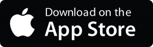

I was recently inspired by <a title="Underscore" href="https://twitter.com/_davidsmith" target="_blank">David Smith</a> on his podcast <a title="Developing Perspective #139" href="https://developingperspective.com/2013/08/21/139/" target="_blank">Developing Perspective</a> to setup an iTunes Affiliate account. As detailed on his <a title="iTunes Affiliate Linking" href="https://www.david-smith.org/blog/2013/08/19/itunes-affiliate-linking/" target="_blank">blog post</a>, it is a relatively straight forward process of <a title="Affiliate Program" href="https://performance-partners.apple.com/" target="_blank">signing up with PHG</a> for an account, and waiting a few days for approval. Once approved, you are given an Affiliate Token (at), which you can append as a parameter to any iTunes URL.

  
  
  

    App Store Affiliate Link
  

Whoever clicks this link is taken to the App Store, and you will receive a commission from sales made by that person. The commission is 7% of any purchases made within 24hrs of clicking the link. On top of this, you can add campaign tokens to the URL, which is great to see which links are being clicked (eg podcast, twitter, blog&#8230;). On the PHG dashboard, you get a pretty graph and breakdown of commission earned.

And of course, if you use the link for yourself, you are effectively getting a discount on any purchases you make. #winning.

&nbsp;

&nbsp;